# Review user flow

What happens when a user reviews a PR — from pressing the review key through the
confirm/warn modals, the off-thread setup, the embedded terminal tab, the live
agent session, and teardown. Every node below is traced from
`cc_pr_reviewer/__init__.py` (line references in the source-map at the bottom),
not from memory.

On POSIX a review runs in its **own embedded terminal tab** (`TerminalPane`, a
PTY + `pyte` emulator) — several reviews run concurrently and the TUI never
suspends. On Windows (no PTY) the launcher falls back to the legacy
`_launch_review_suspend` path, which suspends the whole TUI for one review; that
fallback is not diagrammed here.

```mermaid
flowchart TD
    A([User presses Review key]) --> B["action_review()"]
    B --> C{"_selected()<br/>a PR row?"}
    C -- no --> Z0([return — nothing happens])
    C -- yes --> SC{"already a live tab<br/>for this PR?"}
    SC -- yes --> SCA["_activate_tab → switch to it"]
    SC -- no --> D{"in-progress cache:<br/>self._in_progress[key]"}

    D -- holder exists --> W["InProgressWarnScreen"]
    W --> WD{override?}
    WD -- no --> Z1([abort])
    WD -- "yes (capture holder)" --> CS
    D -- no holder --> CS["ConfirmScreen modal"]

    subgraph CONFIRM["ConfirmScreen — per-launch choices"]
        CS --> CSi["Ctrl+T post-inline · Ctrl+L cycle CLI<br/>checkboxes pick agents · type extra prompt"]
        CSi --> CSk{Enter / Esc}
    end
    CSk -- "Esc / Ctrl+N (cancel → None)" --> Z2([no launch])
    CSk -- "Enter / Ctrl+Y" --> CR["ConfirmResult<br/>(post_inline, extra_prompt, cli, agents)"]
    CR --> L["_begin_review(pr, …, expected_holder)"]

    L --> PF{"_preflight_cli_checks(cli)<br/>(main thread, TUI alive)"}
    PF -- "fail (toast)" --> Z3([abort])
    PF -- ok --> TAB["_add_preparing_tab —<br/>open 'Preparing…' tab, focus it"]
    TAB --> SW[["_review_setup_worker<br/>@work(thread=True) — off the main thread"]]

    subgraph SETUP["_review_setup_worker (background thread)"]
        SW --> RES{"_reserve_in_progress<br/>(same-PR lock)"}
        RES -- "ReviewInProgressError" --> RESX["notify toast ·<br/>_discard_preparing_tab · return"]
        RES -- reserved --> WT{"_prepare_pr_worktree:<br/>clone/fetch primary → worktree add →<br/>gh pr checkout → rev-parse HEAD"}
        WT -- not ok --> SF["compensating teardown<br/>+ discard tab"]
        WT -- ok --> CG["_setup_codegraph_index<br/>(gated on x toggle)"]
        CG --> SK{"cli is skill-based<br/>(codex/gemini)?"}
        SK -- yes --> SKM["_materialise_skills →<br/>.agents/skills/ (snapshot for restore)"]
        SK -- no --> EX
        SKM --> EX["fetch_existing_review_comments<br/>+ _current_gh_login"]
        EX --> SLB{"slack webhook configured?"}
        SLB -- yes --> SLP["fetch_my_latest_review →<br/>pre-session baseline"]
        SLB -- no --> PB
        SLP --> PB["_resolve_codegraph_tools →<br/>build_review_prompt →<br/>_build_cli_command → _ReviewContext"]
    end

    PB --> SPAWN["call_from_thread → _spawn_review_tab (main thread)"]
    SPAWN --> PANE["mount TerminalPane in the tab:<br/>pty.openpty → Popen(cmd, cwd=worktree,<br/>start_new_session) → focus"]
    PANE --> AGENT[["Live embedded terminal (pyte)<br/>reader pump → render_line · keys → PTY<br/>scrollback · concurrent with other tabs"]]

    AGENT --> EXIT["child exits → _on_review_exit(tab_id, rc)<br/>(main thread)"]
    EXIT --> TEL["_record_launch_telemetry<br/>(EVERY exit, success or rc≠0)"]
    TEL --> RC{rc == 0?}
    RC -- "no (Ctrl-C / crash)" --> NR["toast 'not recorded' —<br/>no count++, staleness untouched"]
    RC -- yes --> REC["_record_review:<br/>count++ · reset staleness · store HEAD"]
    REC --> SLN{"slack webhook configured?"}
    SLN -- yes --> SLNOT["_slack_notify_worker →<br/>_notify_review_to_slack (new id AND newer ts)"]
    SLN -- no --> FIN
    SLNOT --> FIN
    NR --> FIN

    subgraph TEARDOWN["_teardown_review_io — same fixed order as the old finally"]
        FIN["_cleanup_skills (restore bytes) →<br/>git worktree remove --force →<br/>_release_in_progress"]
    end
    FIN --> ENDTAB["_mark_tab_ended: ✓/✗ title,<br/>tab stays open · toast 'F4 to close'"]
    ENDTAB --> RESUME["action_refresh()"]
    RESUME --> END([Back to PR list — tab closable with F4])

    RESX --> Z4([slot released, nothing created])
    SF --> Z4
```

## Notes (load-bearing details)

- **Concurrent, non-suspending.** Each review owns a `TerminalPane` (PTY +
  `pyte`) mounted as its own tab under `TabbedContent`; the app never suspends,
  so many reviews run at once. `F2`/`F3` switch tabs, `F4` closes, `Ctrl+Q`
  quits from anywhere — all `priority=True` so a focused terminal can't trap the
  user. On app quit, `_reap_active_reviews` (`on_unmount`) kills every live pane
  (SIGKILL to the process group) and runs each teardown.
- **Setup runs off the main thread.** `_review_setup_worker` is a
  `@work(thread=True)` worker (the whole clone/fetch/worktree/codegraph/skills/
  prompt block), so the UI stays responsive while a repo clones. It opens a
  "Preparing…" tab first, then marshals `_spawn_review_tab` back to the UI
  thread once the argv is built. A failure *after* reserving runs the same
  ordered teardown for whatever completed, then discards the tab.
- **Two-tier in-progress guard.** The `self._in_progress` cache gate is only a
  UX optimisation that surfaces the warn modal early. The *hard* lock is
  `_reserve_in_progress`, taken in the setup worker — even if the cache misses a
  peer that just started, the reserve raises `ReviewInProgressError` and the
  worker aborts with a toast. A live tab for the same PR is short-circuited in
  `action_review` (switch to it) before any of this.
- **The pyte CSI-`>` workaround.** `_strip_unsupported_csi` removes
  `CSI > … <final>` sequences (XTMODKEYS / modifyOtherKeys, which every modern
  CLI emits) before feeding pyte 0.8.2, which otherwise mis-parses `ESC [ > 4 ;
  2 m` as a real SGR and leaves underline+faint stuck on across the screen. A
  `_pending` buffer carries a sequence split across reads.
- **Telemetry on every exit.** `_record_launch_telemetry` writes a row for
  *every* exit (success and `rc≠0`), so aborts and crashes stay visible in the
  data. Only a clean `rc == 0` records a *review* (`_record_review`: count++,
  staleness reset, HEAD stored) and is what triggers the Slack notification
  (offloaded to `_slack_notify_worker` so the POST can't hitch the UI).
- **Fixed teardown order.** `_teardown_review_io` (via `_review_teardown_sequence`)
  always runs the same order — restore skills → remove worktree → release the
  reservation — on clean exit, Ctrl-C, crash, setup failure, and app-quit reap,
  so the slot is never yielded while the worktree still exists. Each step is
  best-effort so one failure can't skip the rest.
- **Ended tabs stay open.** After teardown, `_mark_tab_ended` relabels the tab
  ✓/✗ and leaves it open so the final agent output is readable; the user closes
  it with `F4` (analogous to the old suspend path's "Press Enter to return").
- **Slack is doubly gated.** It fires only when a webhook is configured *and*
  `_notify_review_to_slack` confirms a genuinely new review — a different id from
  the pre-session baseline *and* a newer `submitted_at` timestamp (guards the
  dismiss edge where an older review resurfaces as "latest").
- **Skills are codex/gemini only.** `_materialise_skills` runs only for the
  skill-based CLIs; `claude` drives its sub-agents through the plugin prompt
  instead, so no `.agents/skills/` materialisation happens for it.
- **CodeGraph seeding is gated on the `x` toggle.** When on, the worktree's index
  is seeded from the primary clone and incrementally synced for the PR's diff
  (avoiding a ~30s full re-index per launch); when off, the block is skipped.
- **Windows fallback.** Where `pty` is unavailable, `_begin_review` routes to
  `_launch_review_suspend`, the legacy single-review path that suspends the TUI
  and `subprocess.call`s the CLI on the shared TTY (one review at a time). Not
  diagrammed above.

## Source map

All symbols live in `cc_pr_reviewer/__init__.py`:

| Node | Symbol | Line |
| --- | --- | --- |
| Keypress entry, self-tab short-circuit, in-progress gate, modal push | `action_review` | 5147 |
| Per-launch choices payload | `ConfirmResult` | 3203 |
| Confirm modal | `ConfirmScreen` | 3264 |
| In-progress warn modal | `InProgressWarnScreen` | 3427 |
| Launch entry (preflight + POSIX/Windows dispatch) | `_begin_review` | 5680 |
| Off-thread setup | `_review_setup_worker` | 5717 |
| Spawn CLI in an embedded tab | `_spawn_review_tab` | 5858 |
| Exit: telemetry + record + teardown | `_on_review_exit` | 5890 |
| Ordered teardown (skills → worktree → reservation) | `_teardown_review_io` | 5967 |
| App-quit reaping | `_reap_active_reviews` | 6107 |
| Embedded terminal widget (PTY + pyte) | `TerminalPane` | 3942 |
| pyte CSI-`>` sanitizer | `_strip_unsupported_csi` | 3913 |
| Windows legacy suspend path | `_launch_review_suspend` | 6135 |
| Prompt assembly (pure) | `build_review_prompt` | 2227 |
| Slack notification decision | `_notify_review_to_slack` | 5556 |
| Worktree index seed | `_seed_worktree_codegraph` | 1617 |

Other called helpers: `_preflight_cli_checks`, `_reserve_in_progress`,
`_prepare_pr_worktree`, `_setup_codegraph_index`, `_materialise_skills`,
`fetch_existing_review_comments`, `_resolve_codegraph_tools`,
`_build_cli_command`, `_record_launch_telemetry`, `_record_review`,
`_cleanup_skills`, `_release_in_progress`, `_key_to_bytes`, `_render_pyte_line`.
